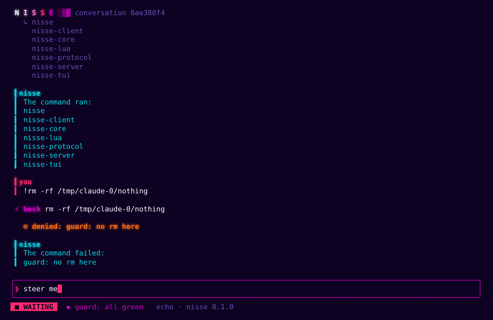

# Nisse

A durable, multiplayer coding agent. One Rust app server owns every conversation
and commits each step to SQLite before anyone sees it; thin clients draw what it
commits. The first is a neon cyberpunk terminal UI, which is also how
[attn](https://github.com/SolenesInc/attn) hosts Nisse. Luau extensions change
what the agent does and what every client draws.



Design: [Nisse: architecture and design](https://claude.ai/artifact/PNaHXc93MxhqwD6QLhXW6y).

## Status

Milestone 1, a real agent. What runs today:

- Two providers. **Claude** runs through the Claude Code CLI and keeps Claude
  Code's own tools; Nisse speaks its stream-json control protocol, commits every
  message and tool call, runs the Luau hooks on each call, and turns Claude
  Code's permission asks into Nisse approvals. **OpenAI** runs through a ChatGPT
  sign-in, as the Codex CLI does, with Nisse running the agent loop and its own
  `Read`, `Write`, `Edit`, `Bash` and `Grep` tools, named and shaped like Claude
  Code's so one Luau hook works for both providers.
- Streaming text, committed at most every 100 ms so every client sees the same
  words; a run a restart cut off answers again from the start.
- Approvals as entries: anyone in the conversation answers, once, from any
  client.
- A SQLite commit log of conversations, entries and submissions. Inputs are
  idempotent by `request_id`, queue as follow-ups or steers that every client
  sees waiting until a run takes them in, and a run cut off by a crash is
  picked up after reopening; Claude resumes its own session at the last
  message Nisse committed.
- Luau extensions with `tool.call` and `prompt.submit` hooks, `nisse.ui.status`
  and `nisse.ui.toast`.
- One server per home, shared by every client. A TUI or `exec` starts it when
  none runs, and it exits once nothing needs it. Each conversation keeps its
  own directory, and its own model, which anyone in it can switch.
- Subagents, each a conversation of its own under the one that started it.
- The neon TUI.

Next: many clients on one conversation (M2). See the design doc for the plan.

## Try it

```sh
cargo build
target/debug/nisse                         # the TUI, with Claude, in this directory
target/debug/nisse providers               # each provider and how it stands
target/debug/nisse models                  # each provider's models and efforts
target/debug/nisse login openai            # sign in with ChatGPT (--device on a headless box)
target/debug/nisse --provider openai       # the TUI, with OpenAI
target/debug/nisse exec 'what is in here?' # one prompt, headless; asks on stdin to approve
target/debug/nisse serve                   # the home's server in the foreground, with its log
target/debug/nisse serve --restart         # replace the running server once its runs settle
target/debug/nisse schema                  # the protocol's JSON Schema
```

`NISSE_HOME` (default `~/.nisse`) holds `config.toml`, `nisse.sqlite`,
`nisse.sock`, `auth/`, `extensions/`, and your own `AGENTS.md` and `skills/`.
One process serves a home at a time. A TUI or `exec` attaches to
`NISSE_HOME/nisse.sock`, and when nothing answers there it starts `nisse serve`
in the background, logging to `NISSE_HOME/nisse.log`. The server exits 30
seconds after the last client leaves and the last run settles.
A conversation runs in the directory its client started it in: tools run
there, Claude Code starts there, and its `.nisse/extensions/` load for it.

| Setting | What it does |
| --- | --- |
| `--provider` / `NISSE_PROVIDER` | Who answers a new conversation: `claude` (default), `openai`, one `config.toml` names, or `echo`, which echoes and runs `!command` without a model |
| `--model` / `NISSE_MODEL` | The new conversation's model, instead of the default one |
| `--effort` / `NISSE_EFFORT` | The new conversation's reasoning effort, such as `low` or `high` |
| `--claude` / `NISSE_CLAUDE` | The `claude` binary a server this starts drives |
| `--code-mode-host` / `NISSE_CODE_MODE_HOST` | Codex's `codex-code-mode-host`, which runs code-mode scripts in a server this starts; otherwise `NISSE_HOME/bin/`, then `PATH` |
| `--record` / `NISSE_RECORD` | Save every provider exchange in this folder as a replayable test fixture, in a server this starts |
| `NO_COLOR`, `NISSE_THEME=plain` | Turn the colours off |

### Code mode

Most of OpenAI's models work in code mode: they get two tools, `exec` and
`wait`, and write JavaScript that calls Nisse's tools. Each call a script makes
is an ordinary Nisse tool call, with its own approval and hooks. Scripts run in
Codex's `codex-code-mode-host`, which Nisse starts on the first script and stops
when idle. Install the pinned release with:

```sh
scripts/code-mode-host.sh   # into NISSE_HOME/bin
```

`gpt-5.5` keeps direct tools and needs no host.
### Providers and sign-in

A provider is a driver and an account. There are always `claude`, `openai` and
`echo`; `NISSE_HOME/config.toml` adds more, or changes those:

```toml
[providers.claude-personal]
driver = "claude"
config_dir = "~/.claude-personal"   # Claude Code's CLAUDE_CONFIG_DIR: its own account
binary = "/opt/claude/bin/claude"   # optional, like env = { ... } and args = [ ... ]

[providers.openai-work]
driver = "openai"                   # a second ChatGPT account, in auth/openai-work.json
```

Claude Code keeps Claude's credentials: Nisse only asks it how it is signed in,
and signing in runs `claude auth login` with the instance's config dir. Nisse
keeps the ChatGPT sign-in itself, readable only by you. The TUI's splash shows
every provider, and `^L` signs in to the first one that is signed out: a
browser opens, or over SSH a code appears to enter on any device. A browser
on another machine can't reach this one, so paste the address it ends on into
the prompt. `nisse login <provider>` and `nisse logout <provider>` do the same
from a shell.

### Models

A conversation's model is its own: a provider, a model and a reasoning effort.
`/model` in the TUI lists every provider's models; `↑↓` picks one, `←→` its
effort, and `⏎` switches from the next run on. The switch is an entry in the
transcript, so everyone in the conversation sees who switched and when.

Switching providers keeps the conversation: OpenAI is sent the whole
transcript, and a new Claude Code session is retold its first turn and as many
of its newest as fit in about 16,000 tokens. Neither hears the other's
reasoning.

A new conversation takes `--provider`, `--model` and `--effort` when they are
given, and otherwise `default_model` from the project's `.nisse/config.toml`,
else from `NISSE_HOME/config.toml`, else the model chosen last, else the first
provider's default:

```toml
default_model = { provider = "openai", model = "gpt-6.1-sol", effort = "high" }
```

A project's `.nisse/config.toml` sets only `default_model`. Claude's models are
the ones Claude Code offers; OpenAI's come from ChatGPT, saved in
`NISSE_HOME/cache/` for starts that can't ask it, and from the list Codex
bundles before that.

### Subagents

A subagent works in a conversation of its own, under the one that started it,
on its parent's provider and in its directory. The parent's transcript shows a
card for each: what it last did, and whether it works, waits on a person or
ended. An approval a subagent waits on shows on its card too, and `^Y` or `^N`
answers it from the parent. `Esc` stops a run, and every subagent under it.

Claude keeps Claude Code's own subagents: Nisse commits what each one does
into its conversation and runs its tool calls through the same hooks and
approvals. A Claude subagent takes input only through its parent. On OpenAI,
Nisse runs Codex's agent tools: `spawn_agent`, `send_message`,
`followup_task`, `wait_agent`, `list_agents` and `interrupt_agent`. A spawned
agent starts from its parent's history unless asked not to, may name another
model of the same provider, and hands its last message to its parent when it
finishes. For a subagent on another provider, start another attn session.

Both providers read agent types from `.claude/agents/*.md`, from the directory
up to the repository root, and from Claude Code's config dir's `agents/`. On
OpenAI a type's `model` applies only when it names an OpenAI model. How deep
subagents nest and how many run at once in one tree are set in
`NISSE_HOME/config.toml`, with Codex's defaults:

```toml
[agents]
max_depth = 1
max_threads = 6
```

### Recording fixtures

Provider tests replay real exchanges. To record OpenAI ones with your sign-in:

```sh
NISSE_RECORD=/tmp/rec target/debug/nisse --provider openai exec 'what does `echo hi` print?'
```

Code-mode turns record the same way; pick a code-mode model with `--model`.
Each turn writes `/tmp/rec/openai-<id>.ndjson` with tokens, ids and paths
replaced by placeholders. Read it for personal text before committing it under
`crates/nisse-openai/tests/fixtures/`. Claude's fixtures re-record with
`NISSE_CLAUDE_LIVE=$(which claude) cargo test -p nisse-claude`.

## AGENTS.md and skills

Claude Code reads its own instructions and skills. On OpenAI, Nisse reads the
same files, as Codex does, from the conversation's directory when each run
starts:

- `NISSE_HOME/AGENTS.md`, then each `AGENTS.md` from the repository root down
  to the directory, where an `AGENTS.override.md` takes its folder's place.
  Together they stop at 32 KiB.
- Skills: folders with a `SKILL.md` whose frontmatter gives `name` and
  `description`, in `.agents/skills/` and `.claude/skills/` from the directory
  up to the repository root, then in `NISSE_HOME/skills/`. The nearest skill of
  a name wins. The model sees each skill's name, description and path, and
  reads the skill when a task matches.
- `/name` at the start of a message, or `$name` anywhere in it, sends the
  skill's `SKILL.md` with the message. It is stored with the message, so the
  conversation keeps the skill as it was.

`skills/list` lists the skills a conversation's clients can offer.

## Extensions

An extension is a folder in `NISSE_HOME/extensions/` or `.nisse/extensions/`
with an `init.luau` that returns `function(on, options)`.

```luau
return function(on)
  on("tool.call", { tool = "Bash" }, function(nisse, e, next)
    if e.args.command:match("^rm ") then
      return { deny = "guard: no rm here" }
    end
    local ran = next(e)
    nisse.ui.status(ran.is_error and "last command failed" or "all green")
    return ran
  end)
end
```

A `tool.call` hook can deny a call, answer it itself, or pass it on with
rewritten `args`; the tool stays the one the model called, so a call can't get
past an approval by turning into another tool. `e.conversation.id` is the
conversation the call is made in, and `e.conversation.parent` the one that
started it, when it is a subagent. A hook on `Agent` or `spawn_agent` can deny
or rewrite a spawn.

Extensions are written in [Luau](https://luau.org). Each one gets its own
sandboxed VM without `io`, `os` or `require`, with read-only globals and a time
budget per hook.

## Layout

| Crate | Owns |
| --- | --- |
| `nisse-protocol` | Wire types, the JSON-RPC envelope, transports, schema export |
| `nisse-core` | The store, conversations, the inbox and runs, turns, approvals, built-in tools |
| `nisse-lua` | Extension loading and the `nisse` table |
| `nisse-claude` | Claude through Claude Code's stream-json control protocol, and its replay |
| `nisse-openai` | OpenAI's Responses API through a ChatGPT sign-in |
| `nisse-server` | Connections and fan-out |
| `nisse-client` | A typed client |
| `nisse-tui` | The neon terminal UI |
| `nisse` | The binary |
